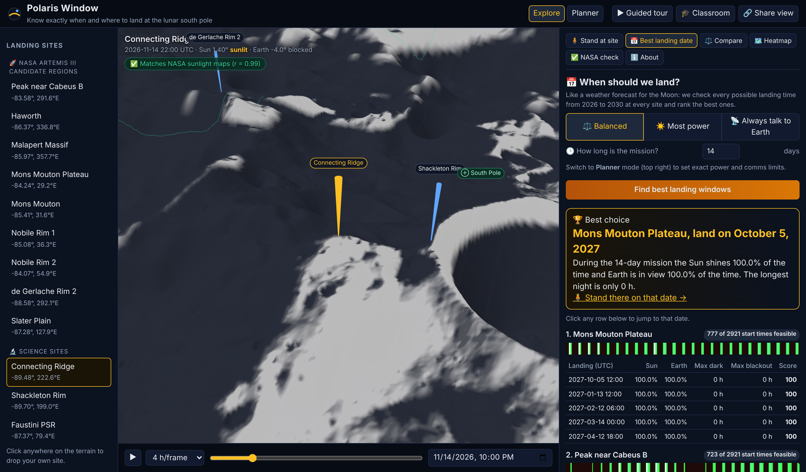
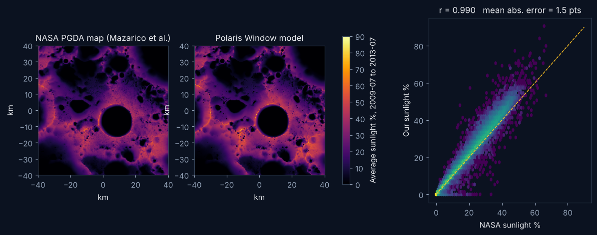

# Polaris Window

**Don't just see the lunar south pole. Know exactly when and where to land.**

NASA Space Apps Challenge 2026: *Lunar Landing Site Navigator*

**▶ Try it live: https://amirtheshwaran.github.io/polaris-window/** · [Guided tour](https://amirtheshwaran.github.io/polaris-window/) · [Classroom missions](https://amirtheshwaran.github.io/polaris-window/learn.html) · [30-second demo mode](https://amirtheshwaran.github.io/polaris-window/#demo=1)

| | |
|---|---|
|  |  |
| **3D south pole** from NASA LOLA terrain, with the nine Artemis III candidate regions (official USGS footprints) | **Stand at site:** the real horizon, with the Sun path (gold) and Earth path (blue) |
|  |  |
| **Best landing date:** ranks every landing slot from 2025 to 2030 | **Best landing spots:** sun + Earth + flat ground for any date range |


*Validation: our model (center) reproduces NASA's published south-pole illumination map (left) with r = 0.990.*

Polaris Window is a browser-based mission planner for the lunar south pole. It uses real NASA terrain and ephemeris to answer the planner's question directly: *which site, and which landing date, gives us the power and the direct-to-Earth comms we need?*

## Features

| | |
|---|---|
| **Live 3D south pole** | 384 × 384 km of NASA LOLA terrain (80 m DEM). Scrub or play the timeline and watch real shadows sweep across the craters. The shadows come from the same horizon model used in every statistic. |
| **Stand at site** | 360° horizon panorama for any site, showing the Sun path and Earth path for the next lunation, with the current Sun and Earth drawn against the real skyline. One click drops you to the surface in 3D. |
| **Auto window finder** | Enter a mission length and minimum sunlight, Earth visibility, darkness and blackout limits. It scores every 6-hour landing slot from 2025 to 2030 at every site and ranks the best non-overlapping windows. |
| **Side-by-side compare** | 2 to 4 sites: sunlight %, Earth visibility %, sun AND Earth %, longest darkness, longest comms blackout and solar energy, plus charts for each lunation. |
| **Heatmap mode** | Colors the whole region by sunlight, Earth visibility, or both, for any date range. It's computed live in the browser from 131k precomputed terrain horizons. |
| **Drop your own site** | Click anywhere on the terrain. Custom sites get full statistics, a panorama and window ranking. |
| **Checked against NASA** | Our illumination map reproduces NASA PGDA's published south-pole average-illumination map with r = 0.99 (mean error 1.5 points), and our Sun and Earth elevations match JPL Horizons to 0.001°. |
| **Shareable links** | Every view (site, date, tab, heatmap, custom site) is encoded in the URL, so educators can send a class to an exact moment. |
| **Explore / Planner modes + guided tour** | An 8-step narrated tour for classrooms and the public, and full controls for planners. |

## How it works

```
LOLA LDEM_80S_80M (NASA PDS) ─┐
                              ├─ pipeline/build.py ── horizon ray-marching (Numba, lunar curvature, 220 km reach)
NAIF SPICE DE440 + MOON_ME  ──┤                    ── hourly Sun/Earth vectors 2025–2030 in the LOLA frame
NASA PGDA illumination maps ──┴─ pipeline/validate.py ── pixel-by-pixel validation + JPL Horizons cross-check
                                        │
                                        ▼
                     web/data/*.bin  (static, about 18 MB)  ──►  Three.js + Chart.js app on GitHub Pages
```

* **Horizons:** for each grid point (two 256 × 256 grids: 1.5 km over ±192 km, 312 m over the central ±40 km), we march rays in 120 directions across the DEM and keep the maximum elevation angle, including lunar curvature (`d²/2R`). Named sites use 720 directions on the full 80 m DEM.
* **Ephemeris:** SPICE `spkpos` gives Sun and Earth in `MOON_ME`, the same body-fixed frame as LOLA, hourly from 2025 to 2030 (43,824 steps).
* **In the browser:** for any site and time, convert the Sun and Earth vectors to local azimuth and elevation, then compare them with the terrain horizon at that azimuth. Sunlight uses the solar disc fraction. Earth visibility uses a line of sight to Earth's center, with topocentric parallax.
* There's no backend, so nothing can crash during judging.

## Run locally

```bash
cd web && python3 -m http.server 8000   # open http://localhost:8000
```

Rebuild data (about 3 minutes on 4 cores):

```bash
pip install numpy scipy numba spiceypy matplotlib
python pipeline/build.py <raw_dir>      # raw_dir: ldem_80s_80m.img, SPICE kernels, avgvisib_75s_120m_201608.img
python pipeline/validate.py <raw_dir>
```

## Data sources

* NASA LRO LOLA gridded polar DEM `LDEM_80S_80M` from the PDS Geosciences Node
* NASA/JPL NAIF SPICE kernels: `de440s.bsp`, `moon_pa_de440_200625.bpc`, `moon_de440_250416.tf`, `pck00011.tpc`, `naif0012.tls`
* NASA GSFC PGDA Lunar Polar Illumination `AVGVISIB_75S_120M_201608` (Mazarico et al., 2011, Icarus 211), used for validation
* JPL Horizons API, used for ephemeris validation

## Assumptions and limits

Observer height is 2 m. The nine NASA Artemis III candidate regions (Oct 2024) use official USGS footprints (McClernan 2024, doi:10.5066/P1MEQ6UK); Mons Mouton Plateau uses an approximate 15 km box. Each region pin is our best spot inside it (most sun + Earth on slope ≤ 8°), not a NASA-designated landing point. Custom-site horizons are interpolated from the precomputed grids (120 azimuths). Power assumes a 10 m², 30%-efficient, vertical sun-tracking array. The tool doesn't model relay satellites (only direct-to-Earth) or hazards smaller than the 80 m terrain grid (rocks, small craters).

