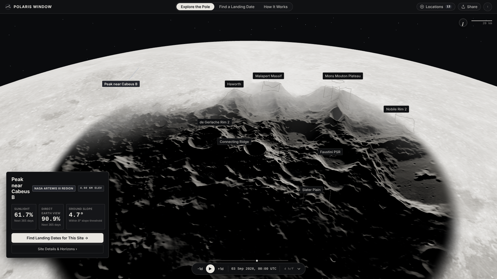
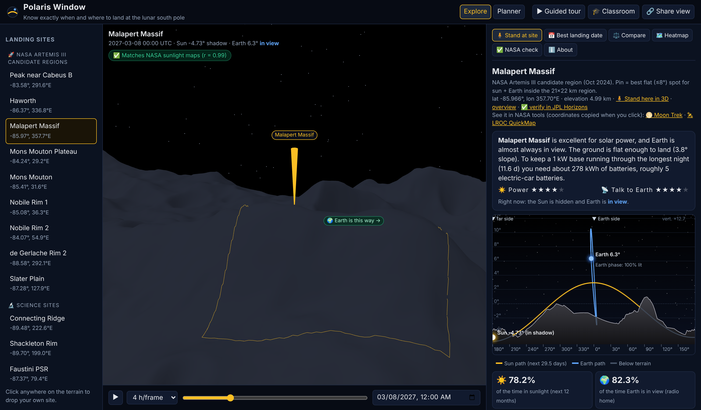
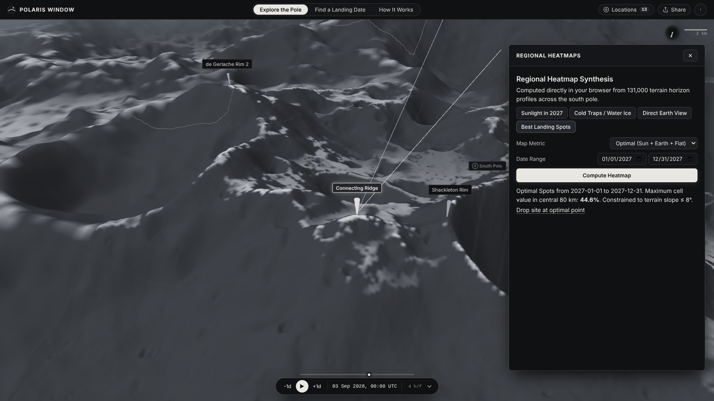
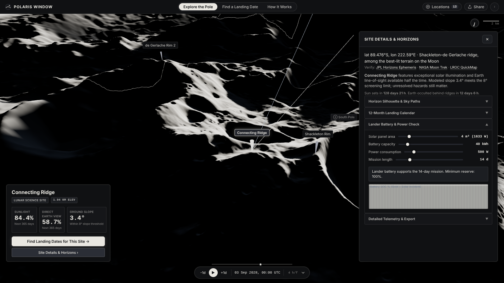
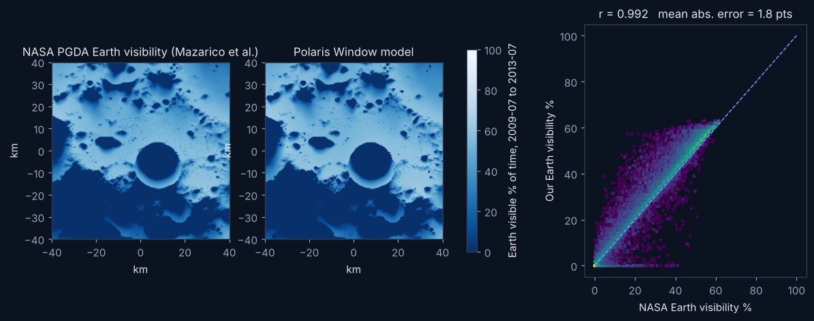
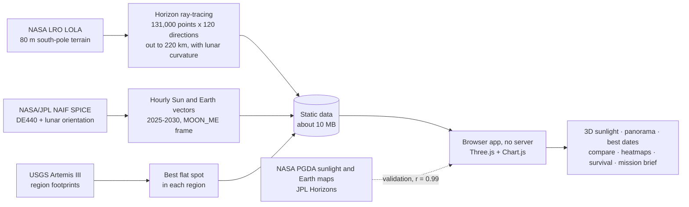

# Polaris Window

**Don't just see the lunar south pole. Know exactly when and where to land.**

NASA Space Apps Challenge 2026: *Lunar Landing Site Navigator*

**▶ Try it live: https://amirtheshwaran.github.io/polaris-window/** · [Guided tour](https://amirtheshwaran.github.io/polaris-window/) · [Classroom missions](https://amirtheshwaran.github.io/polaris-window/learn.html) · [30-second demo mode](https://amirtheshwaran.github.io/polaris-window/#demo=1)

| | |
|---|---|
|  |  |
| **3D south pole** from NASA LOLA terrain, with the nine Artemis III candidate regions (official USGS footprints) | **Stand at site:** the real horizon, with the Sun path (gold) and Earth path (blue) |
|  |  |
| **Best landing date:** ranks every landing slot from 2025 to 2030 | **Best landing spots:** sun + Earth + flat ground for any date range |
|  |  |
| **Will your lander survive?** Battery simulated hour by hour from real sunlight | **Comms check:** our Earth-visibility map vs NASA's (r = 0.992) |


*Validation: our model (center) reproduces NASA's published south-pole illumination map (left) with r = 0.990.*

Polaris Window is a browser-based mission planner for the lunar south pole. It uses real NASA terrain and ephemeris to answer the planner's question directly: *which site, and which landing date, gives us the power and the direct-to-Earth comms we need?*

## Features

| | |
|---|---|
| **Live 3D south pole** | 384 × 384 km of NASA LOLA terrain (80 m DEM). Scrub or play the timeline and watch real shadows sweep across the craters. The shadows come from the same horizon model used in every statistic. |
| **Stand at site** | 360° horizon panorama for any site, showing the Sun path and Earth path for the next lunation, with the current Sun and Earth drawn against the real skyline. One click drops you to the surface in 3D. |
| **Auto window finder** | Enter a mission length and minimum sunlight, Earth visibility, darkness and blackout limits. It scores every 6-hour landing slot from 2025 to 2030 at every site and ranks the best non-overlapping windows. |
| **Side-by-side compare** | Compare 2 to 4 sites, or compare up to 4 landing dates at one site: sunlight %, Earth visibility %, sun AND Earth %, longest darkness, longest comms blackout and solar energy, plus charts for each lunation. |
| **Heatmap mode** | Colors the whole region by sunlight, Earth visibility, or both, for any date range. It's computed live in the browser from 131k precomputed terrain horizons. |
| **12-month landing forecast** | A calendar for any site: one square per day, green for sun and Earth all day, yellow for partly, blue for sun without Earth, dark red for night. Click a day to go there. |
| **Will your lander survive?** | Pick a solar panel, battery and power use, and the battery is simulated hour by hour with the real sunlight at that site and date. It's a game for students and a sizing check for planners. |
| **Sight-lines and ice map** | Lines from the selected site to the Sun and Earth (solid = clear, dashed = blocked by terrain), plus a one-click map of places that never saw the Sun from 2025 to 2030, where water ice can survive. |
| **Real CLPS case study** | IM-2 *Athena* (March 2025): our model shows its site and date were excellent, and that it was lost to a crater too small for 80 m maps, which explains why finer hazard maps come next. |
| **Drop your own site** | Click anywhere on the terrain. Custom sites get full statistics, a panorama and window ranking. |
| **Checked against NASA** | Our sunlight map reproduces NASA PGDA's published south-pole illumination map with r = 0.990 (mean error 1.5 points), our Earth-visibility (comms) map reproduces NASA's Earth-visibility map with r = 0.992 (mean error 1.8 points), and our Sun and Earth elevations match JPL Horizons to 0.001°. |
| **Mission brief** | One click produces a printable or PDF report for the chosen site and landing date: key numbers, safety margin, panorama, 60-day outlook and a day-by-day table. |
| **Shareable links + QR** | Every view (site, date, tab, heatmap, custom site) is encoded in the URL. The share dialog also shows a QR code, so a teacher can put it on a projector and students open the exact moment on their phones. |
| **Explore / Planner modes + guided tour** | An 8-step narrated tour for classrooms and the public, and full controls for planners. |

## Why this is easier than existing tools

The challenge notes that tools for Sun and Earth positions exist, but their interfaces make quick decisions hard. Here is what changes:

| Planner question | With existing tools | With Polaris Window |
|---|---|---|
| Is the Sun up at my site right now? | Query JPL Horizons for Sun azimuth and elevation, then compare against a terrain horizon you build yourself from LOLA data | Pick the site: the panorama shows the Sun against the real horizon |
| When can we talk to Earth? | Repeat the Horizons query for Earth, hour by hour, and check terrain blocking by hand | The Earth path and a 60-day strip show every blackout |
| Which landing date is best for a 14-day mission? | Script thousands of ephemeris queries plus horizon checks | Enter the mission rules: every date from 2025 to 2030 is ranked in about a second |
| Which of the Artemis III regions is best? | Repeat all of the above for each region | Compare up to 4 sites side by side, or ask the window finder for all 9 regions at once |
| Can my lander survive the night? | Build your own power model | Move three sliders |
| Can I trust the numbers? | n/a | Checked against NASA's published sunlight and Earth-visibility maps (r = 0.99) and JPL Horizons (0.001°) |

## How it works



* **Horizons:** for each grid point (two 256 × 256 grids: 1.5 km over ±192 km, 312 m over the central ±40 km), we march rays in 120 directions across the DEM and keep the maximum elevation angle, including lunar curvature (`d²/2R`). Named sites use 720 directions on the full 80 m DEM.
* **Ephemeris:** SPICE `spkpos` gives Sun and Earth in `MOON_ME`, the same body-fixed frame as LOLA, hourly from 2025 to 2030 (52,584 steps).
* **In the browser:** for any site and time, convert the Sun and Earth vectors to local azimuth and elevation, then compare them with the terrain horizon at that azimuth. Sunlight uses the solar disc fraction. Earth visibility uses a line of sight to Earth's center, with topocentric parallax.
* There's no backend, so nothing can crash during judging.

## Run locally

```bash
cd web && python3 -m http.server 8000   # open http://localhost:8000
```

Run the tests: `python -m pytest tests -q`. Test the site exactly as GitHub Pages serves it (gzip in transit): `python tools/serve_like_pages.py web 8000`.

Rebuild data (about 3 minutes on 4 cores):

```bash
pip install numpy scipy numba spiceypy matplotlib
python pipeline/build.py <raw_dir>      # raw_dir: ldem_80s_80m.img, SPICE kernels, avgvisib_75s_120m_201608.img
python pipeline/validate.py <raw_dir>
```

## Data sources

* NASA LRO LOLA gridded polar DEM `LDEM_80S_80M` from the PDS Geosciences Node
* NASA/JPL NAIF SPICE kernels: `de440s.bsp`, `moon_pa_de440_200625.bpc`, `moon_de440_250416.tf`, `pck00011.tpc`, `naif0012.tls`
* NASA GSFC PGDA Lunar Polar Illumination `AVGVISIB_75S_120M_201608` (Mazarico et al., 2011, Icarus 211), used for validation
* JPL Horizons API, used for ephemeris validation

## Assumptions and limits

Observer height is 2 m. The nine NASA Artemis III candidate regions (Oct 2024) use official USGS footprints (McClernan 2024, doi:10.5066/P1MEQ6UK); Mons Mouton Plateau uses an approximate 15 km box. Each region pin is our best spot inside it (most sun + Earth on slope ≤ 8°), not a NASA-designated landing point. Custom-site horizons are interpolated from the precomputed grids (120 azimuths). Power assumes a 10 m², 30%-efficient, vertical sun-tracking array. Earth counts as visible when its center is above the terrain; Planner mode can require an antenna elevation mask of 1–5°. The tool doesn't model relay satellites (only direct-to-Earth) or hazards smaller than the 80 m terrain grid (rocks, small craters).

